<p align="center">
  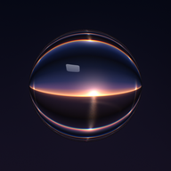
</p>

<h1 align="center">Glass</h1>

<p align="center">
  A new interface for Android TV, made of glass.<br>
  No ads, half the memory, and your phone as the remote.
</p>

<p align="center">
  <a href="https://www.glass-83eb5066.workers.dev"><b>Website</b></a> &nbsp;·&nbsp;
  <a href="https://www.glass-83eb5066.workers.dev/docs"><b>Docs</b></a> &nbsp;·&nbsp;
  <a href="#set-it-up"><b>Set it up</b></a> &nbsp;·&nbsp;
  <a href="CHANGELOG.md"><b>Changelog</b></a>
</p>

<br>

<picture>
  <source media="(prefers-color-scheme: dark)" srcset="docs/readme/desktop-dark.webp">
  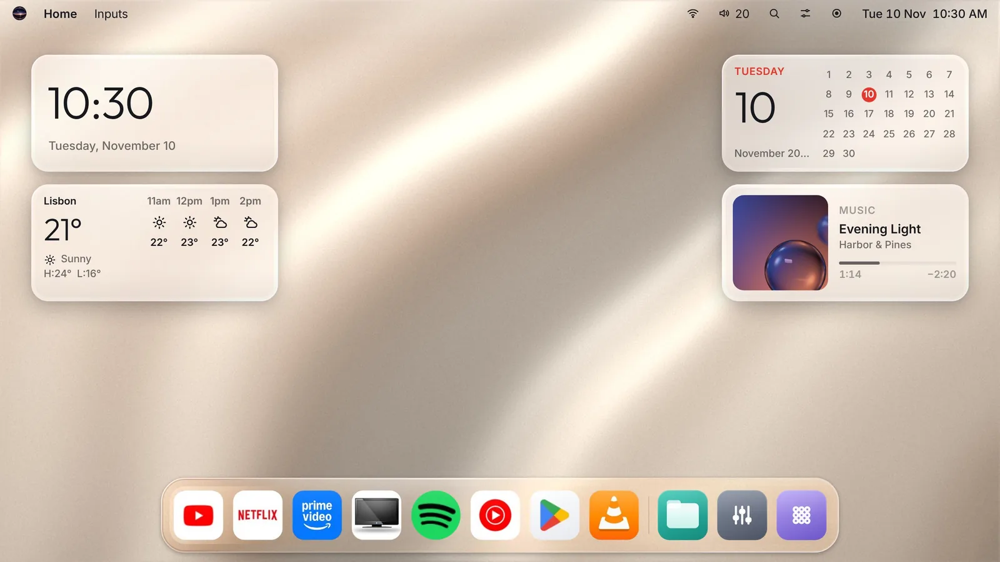
</picture>

<br><br>

Glass replaces your Android TV's home screen with a desktop of your apps and widgets on glass, a Control Center, a
smarter assistant and a remote in your phone's browser. It's free, needs no root, and one command takes it off again.

## Set it up

On a Mac or Linux computer on the same Wi-Fi as the TV. About 15 minutes the first time.

1. **On the TV**, open Settings › Device Preferences › About and press OK on **Build** seven times. Then in Developer
   options, turn on **USB debugging** (and **Network debugging** if it's there).
2. **On the computer**, run:

   ```sh
   curl -fsSL https://www.glass-83eb5066.workers.dev/install.sh | sh
   ```

3. **On the TV**, choose **Always allow** when it asks, twice.

<picture>
  <source media="(prefers-color-scheme: dark)" srcset="docs/readme/installer-dark.webp">
  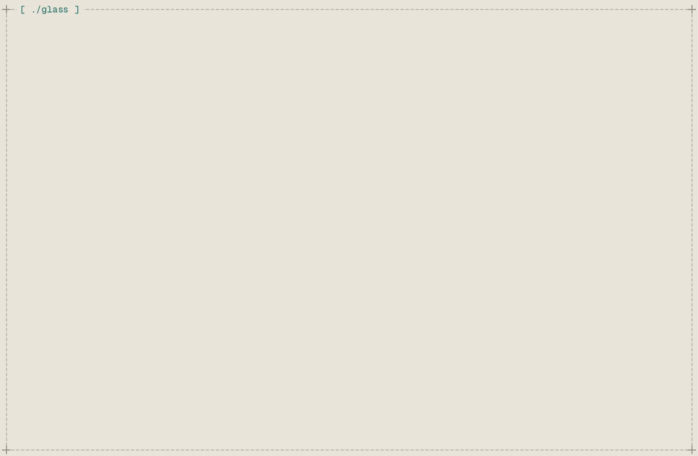
</picture>

The installer gets its own tools into `~/.glass`, finds the TV, builds Glass with your own signing key and makes it the
TV's home screen. Nothing system-wide, no administrator password. Keep a copy of `~/.glass/glass.keystore`: updates
only install with it.

## Lighter and quicker

Measured on the same TV, against its own home screen.

| | Glass | The TV's own home | |
|---|--:|--:|:--|
| Memory on its home | **29 MB** | 71 MB | 2.4× less |
| Memory while you watch | **33 MB** | 82 MB | 2.5× less |
| Opening from cold | **0.63 s** | 1.06 s | 1.7× faster |
| Slowest frame in 100 | **30 ms** | 129 ms | 4.3× quicker |
| App size | **5.0 MB** | 7.4 MB | 32% smaller |

<sub>A 720p TV with 1 GB of memory and Android TV 9; each home started the same way, the middle of five runs.
<a href="https://www.glass-83eb5066.workers.dev/docs#performance">Every number</a>.</sub>

On a slow TV, **Settings › Speed & memory** frees more: it closes the apps waiting in the background, makes the TV's
animations quicker, keeps the apps you choose from running in the background, and turns off the TV's own extras you
don't use. Nothing is uninstalled, and `./glass restore` turns it all back on.

## Made of glass

Every pane bends the wallpaper behind it. Light by day, dark by night.

<table>
  <tr>
    <td width="50%" valign="top">
      <picture>
        <source media="(prefers-color-scheme: dark)" srcset="docs/readme/controls-dark.webp">
        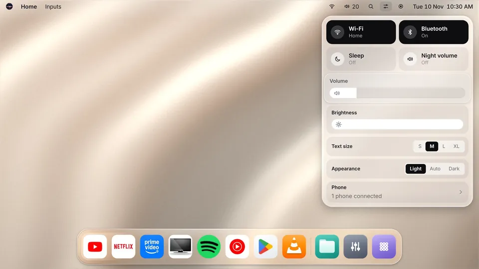
      </picture>
      <b>Control Center</b><br>Press Menu in any app.
    </td>
    <td width="50%" valign="top">
      <picture>
        <source media="(prefers-color-scheme: dark)" srcset="docs/readme/switcher-dark.webp">
        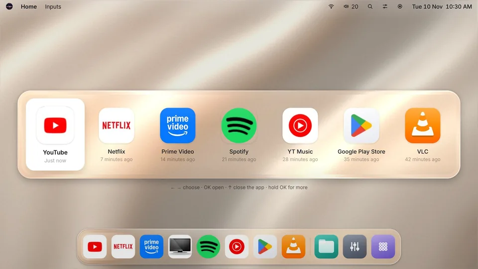
      </picture>
      <b>Open apps</b><br>Hold Home for the apps that are open.
    </td>
  </tr>
  <tr>
    <td width="50%" valign="top">
      <picture>
        <source media="(prefers-color-scheme: dark)" srcset="docs/readme/search-dark.webp">
        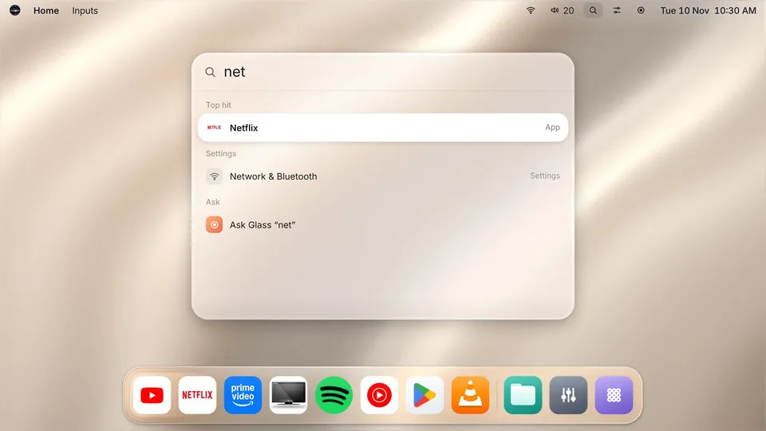
      </picture>
      <b>Search</b><br>Apps, settings, files and questions, in one box.
    </td>
    <td width="50%" valign="top">
      <picture>
        <source media="(prefers-color-scheme: dark)" srcset="docs/readme/settings-dark.webp">
        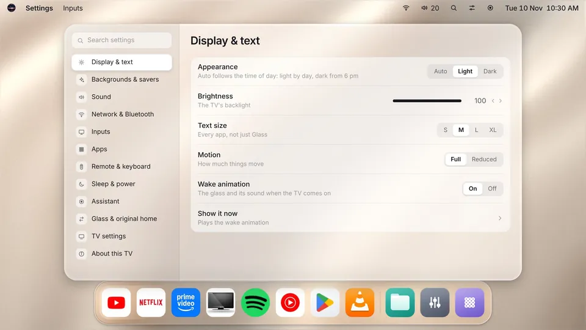
      </picture>
      <b>Settings</b><br>Every setting in one window, with search. Speed &amp; memory frees up a slow TV.
    </td>
  </tr>
  <tr>
    <td width="50%" valign="top">
      <picture>
        <source media="(prefers-color-scheme: dark)" srcset="docs/readme/ask-watch-dark.webp">
        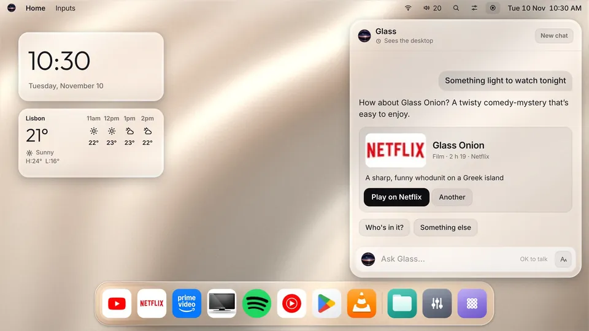
      </picture>
      <b>Glass Assistant</b><br>TV commands work offline. With a free AI key, it answers the rest.
    </td>
    <td width="50%" valign="top">
      <picture>
        <source media="(prefers-color-scheme: dark)" srcset="docs/readme/weather-dark.webp">
        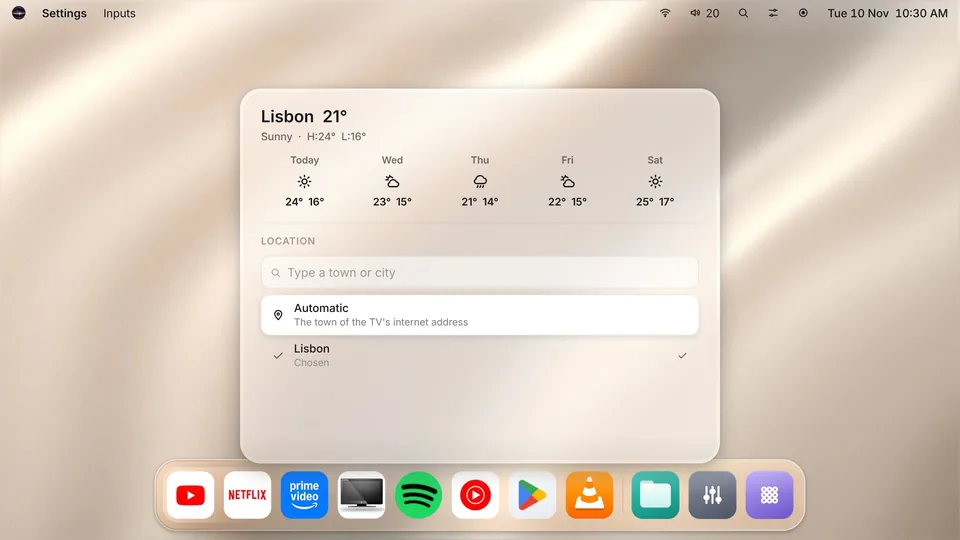
      </picture>
      <b>Weather</b><br>Today and the next four days.
    </td>
  </tr>
</table>

## Your remote, and your phone

The remote's spare buttons do more.

<picture>
  <source media="(prefers-color-scheme: dark)" srcset="docs/readme/remote-dark.webp">
  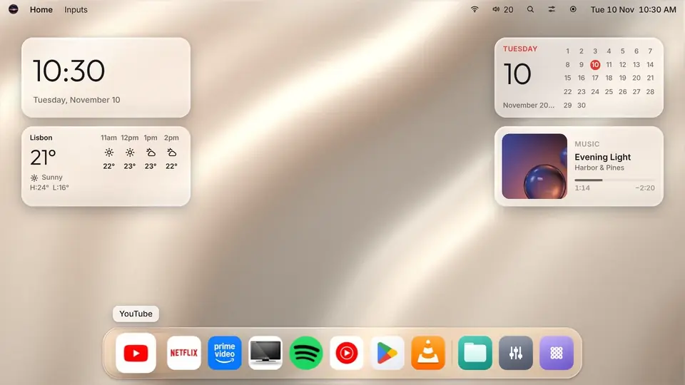
</picture>

| Press | And |
|---|---|
| ← → | Move along the dock |
| Menu | Control Center, in any app |
| Hold Home | The apps that are open |
| Input | The TV's sources |
| Assistant, or the mic | Ask Glass, listening |

Your phone becomes a remote too: scan the code on the TV, and it opens in the phone's browser. Nothing to install,
and only on your home network.

<p align="center">
  <picture><source media="(prefers-color-scheme: dark)" srcset="docs/readme/phone-remote-dark.webp">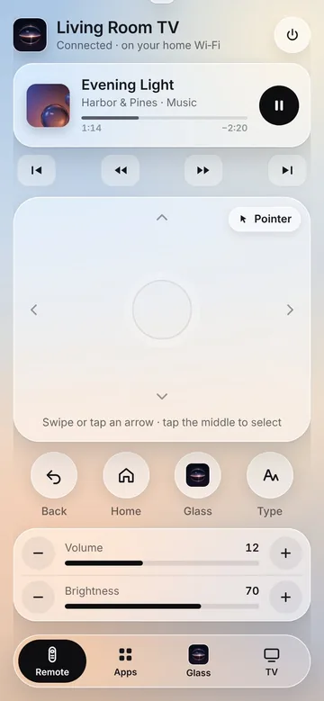</picture>
  <picture><source media="(prefers-color-scheme: dark)" srcset="docs/readme/phone-apps-dark.webp">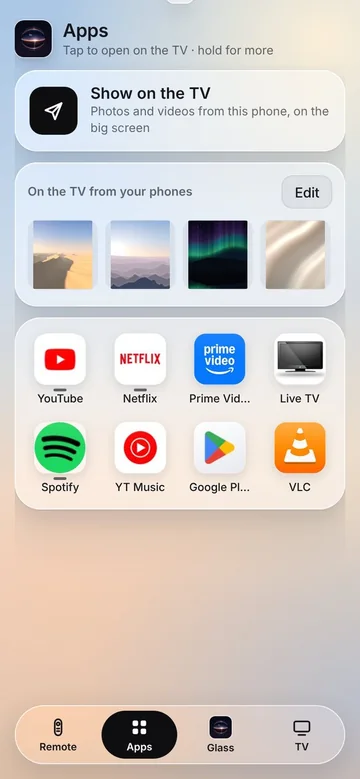</picture>
  <picture><source media="(prefers-color-scheme: dark)" srcset="docs/readme/phone-assistant-dark.webp">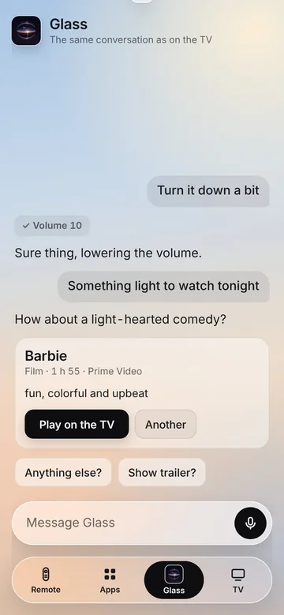</picture>
  <picture><source media="(prefers-color-scheme: dark)" srcset="docs/readme/phone-tv-dark.webp">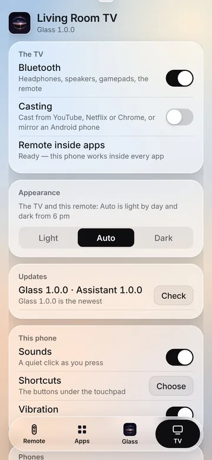</picture>
</p>

## Commands

Run them in the `glass-tv` folder. After the first setup, `./glass` alone opens a menu of all of them.

| | |
|---|---|
| `./glass update` | The newest Glass on the TV. Every setting stays |
| `./glass status` | How the TV and Glass are doing |
| `./glass doctor` | Checks twelve things and offers to fix what's off |
| `./glass restore` | Removes Glass. The TV is as it was |
| `./glass demo` | The installer, with nothing really happening |

`--tv 192.168.1.20` skips the search for the TV, `--yes` takes every recommended answer, `--plain` prints plain lines.

## Privacy

- No accounts, no ads, no tracking.
- What leaves the TV, only when you use it: the weather (to Open-Meteo), your questions (to the AI service you chose)
  and update checks.
- The phone remote never leaves your home network.

## Remove it

```sh
./glass restore
```

The TV's own home, keyboard and assistant button come back, with any of its apps you turned off in
Settings › Speed & memory, then Glass goes. Your apps stay.

## Under the hood

Two apps, signed with the same key: **Glass** (`launcher/`, `com.gathin.tvhome`), the home screen and everything on
it, and **Glass Assistant** (`assistant/`, `com.gathin.glass.assistant`), what the remote's assistant button opens.
The installer is `./glass`, Python 3 with nothing to install.

- [docs/MAINTAINING.md](docs/MAINTAINING.md): your own update service, releasing, the tools, keys, what's where
- [docs/RUNBOOK.md](docs/RUNBOOK.md): when something stops
- [DESIGN.md](DESIGN.md): Glass's design language
- [docs/design/](docs/design/): the installer and the website

Glass started from the open-source tvhome launcher. Fonts, pictures and libraries from elsewhere, and their licences,
are in [NOTICE.md](NOTICE.md).
